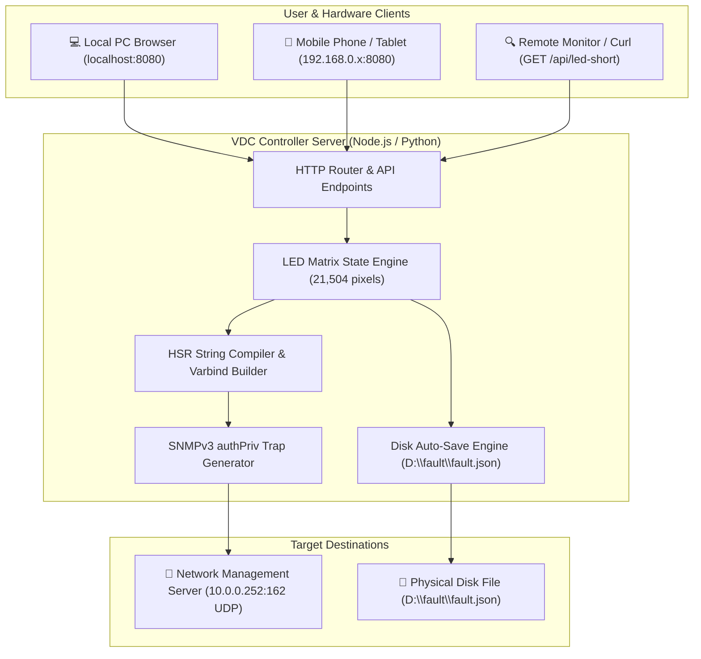

# 🚆 Topgrip IPIS / VDC AVDB (192×112) SNMPv3 Trap Controller & LED Matrix Simulator

> **Official RDSO / Topgrip IPIS Specification (PEN 66731)**  
> Production-grade SNMPv3 `authPriv` Trap Controller, 192×112 LED Diode Matrix Fault Simulator, Live HSR String Compiler, Multi-Interface Network Manager, and Automatic Disk Storage Logger.

---

## 📑 Table of Contents
1. [Overview & System Architecture](#-overview--system-architecture)
2. [Step-by-Step Getting Started Guide](#-step-by-step-getting-started-guide)
   - [Step 1: Prerequisites](#step-1-prerequisites)
   - [Step 2: Clone and Install Dependencies](#step-2-clone-and-install-dependencies)
   - [Step 3: Launching the Application](#step-3-launching-the-application)
   - [Step 4: Accessing the Web & Mobile Interface](#step-4-accessing-the-web--mobile-interface)
   - [Step 5: Verifying with Automated Tests](#step-5-verifying-with-automated-tests)
3. [Step-by-Step Codebase Analysis & Technical Walkthrough](#-step-by-step-codebase-analysis--technical-walkthrough)
   - [Module 1: Dual-Network Adapter Auto-Detection (`server.js` / `server.py`)](#module-1-dual-network-adapter-auto-detection)
   - [Module 2: Automatic Disk Storage Engine (`D:\fault\fault.json`)](#module-2-automatic-disk-storage-engine)
   - [Module 3: Topgrip IPIS 13 Varbind Construction (PEN 66731)](#module-3-topgrip-ipis-13-varbind-construction)
   - [Module 4: SNMPv3 Trap Transmission (`authPriv`)](#module-4-snmpv3-trap-transmission)
   - [Module 5: Interactive 192×112 Canvas Simulator (`public/app.js`)](#module-5-interactive-192112-canvas-simulator)
   - [Module 6: Shareable Public REST APIs](#module-6-shareable-public-rest-apis)
4. [Hardware & RDSO Protocol Specifications](#-hardware--rdso-protocol-specifications)
   - [SNMPv3 Security Profile](#snmpv3-security-profile)
   - [Event Codes & HSR Syntax](#event-codes--hsr-syntax)
   - [13 Topgrip IPIS Varbinds Reference](#13-topgrip-ipis-varbinds-reference)
5. [Automated Verification Suite (`test_endpoints.js`)](#-automated-verification-suite)
6. [Troubleshooting & Frequently Asked Questions](#-troubleshooting--frequently-asked-questions)

---

## 🌟 Overview & System Architecture

This software acts as an **Emulated Video Display Controller (VDC)** for Indian Railways Integrated Passenger Information Systems (IPIS). It simulates an **At-a-Glance Video Display Board (AVDB)** comprising **192 horizontal columns × 112 vertical rows** (21,504 individual LED pixels).

### Key Capabilities:
- **Pixel-Level Fault Injection**: Click any diode on the interactive matrix to simulate a **Short Circuit** (Red) or **Open Circuit** (Amber).
- **HSR Auto-Encoder**: Compiles faults into standard `#`-delimited Health Status Report strings (`S-L1R10C15# O-L1R20C30`).
- **SNMPv3 `authPriv` Dispatcher**: Transmits compliant RFC 3414 traps with HMAC-SHA-256 authentication and AES-128 encryption directly to the central NMS (`10.0.0.252:162`).
- **Disk Auto-Save (`D:\fault\fault.json`)**: Synchronizes every fault change directly to a JSON file on physical disk for external hardware monitors.
- **Dual-Interface Management**: Separates phone/tablet Wi-Fi access (`192.168.0.x`) from Topgrip NMS hardware Ethernet (`10.0.0.x`).
- **Shareable HTTP GET API**: Allows any engineer or client on the local network to query real-time LED health via standard JSON or plain-text HSR.



---

## 🚀 Step-by-Step Getting Started Guide

If you are new to this project or setting it up on a fresh machine, follow these steps:

### Step 1: Prerequisites
Make sure your computer has either **Node.js** or **Python** installed:
- **Node.js**: Version 16.x or newer (recommended; includes `npm`). Check with `node -v`.
- **Python**: Version 3.8 or newer (optional alternative backend). Check with `python --version`.

---

### Step 2: Clone and Install Dependencies

1. Open your terminal (PowerShell, Command Prompt, or Bash) and clone the repository:
   ```bash
   git clone https://github.com/surajit21102004/vdc-trap-send.git
   cd vdc-trap-send
   ```

2. Install Node.js dependencies:
   ```bash
   npm install
   ```
   *This installs `express` (web server), `net-snmp` (SNMPv3 protocol stack), and `qrcode` (mobile QR code generator).*

3. *(Optional - if using Python)*:
   ```bash
   pip install pysnmp
   ```

---

### Step 3: Launching the Application

You can start the application using any of the following 3 methods:

#### Method A: 1-Click Launch (Windows)
Double-click the **`start.bat`** file in the root directory.  
It automatically:
- Checks if port 8080 is occupied by an old process and frees it.
- Starts `node server.js` (or `python server.py` as fallback).
- Opens the command window with live access URLs and NMS credentials.

#### Method B: Using Node.js via Terminal
```bash
npm start
# or
node server.js
```

#### Method C: Using Python via Terminal
```bash
python server.py
```

Upon startup, the console displays:
```text
================================================================
🚆 TOPGRIP IPIS / VDC AVDB (192x112) SNMPv3 TRAP CONTROLLER
================================================================
📡 Local PC Access:          http://localhost:8080
📱 Wi-Fi / Phone Access:     http://192.168.0.103:8080  (Scan QR on same Wi-Fi)
🔌 Ethernet / Device Access: http://10.0.0.254:8080   (IPIS / NMS Network)
🔍 LED Short/Fault GET API:  http://192.168.0.103:8080/api/led-short
💾 Disk Fault Auto-Save:     D:\fault\fault.json
🎯 Target NMS Destination:   10.0.0.252:162 (UDP)
🔐 SNMPv3 USM User:          ipisMgmt_Admin (authPriv HMAC-SHA-256 / AES-128)
🏷️ Trap Notification OID:    1.3.6.1.4.1.66731.5.11
📺 Board Simulation:         AVDB (192x112)
================================================================
```

---

### Step 4: Accessing the Web & Mobile Interface

#### 1. From the Host PC
Open your web browser and navigate to:
```
http://localhost:8080
```

#### 2. From a Mobile Phone or Tablet (Same Wi-Fi)
1. Ensure your phone is connected to the same Wi-Fi router as the host PC.
2. Open your phone browser and go to:
   ```
   http://192.168.0.103:8080
   ```
   *(Or click the **📱 Phone Wi-Fi QR** button on the PC screen and scan the QR code).*
3. **Important Note on IP Addresses**:
   - Wi-Fi IP (`192.168.0.x`): Use this for phones and wireless devices.
   - Ethernet IP (`10.0.0.254`): Used strictly for the physical Topgrip NMS equipment LAN cable. Phones cannot route to `10.0.0.254`.

---

### Step 5: Verifying with Automated Tests

To verify that all 11 subsystems (APIs, trap generation, filters, and disk file storage) are operating properly, run the test script:
```bash
node test_endpoints.js
```

Expected output:
```text
🧪 Starting End-to-End API and Trap Verification Tests...
1️⃣ Testing GET /api/network-info... Status: 200
2️⃣ Testing GET /api/config... Target NMS: 10.0.0.252:162
3️⃣ Testing POST /api/send-preset [CLEAR] (Event 100)... Status: SUCCESS
4️⃣ Testing POST /api/send-preset [SHORT] (Event 102)... Status: SUCCESS
5️⃣ Testing POST /api/send-preset [OPEN] (Event 103)... Status: SUCCESS
6️⃣ Testing POST /api/send-preset [MATRIX_STATE] with Multi-Fault (#)... Status: SUCCESS
7️⃣ Testing GET /api/history... Total Traps: 4
8️⃣ Testing GET /api/led-short (Normal GET API for LED Faults)... Board Status: FAULT
9️⃣ Testing GET /api/led-short?type=short and ?raw=hsr... Filtered SHORT faults count: 1
🔟 Testing Clear Trap and verifying GET /api/led-short returns HEALTHY... Board Status: HEALTHY
1️⃣1️⃣ Testing Auto-Saved Disk JSON File Storage (/api/fault-file)... File Storage Status: 200
🎉 ALL 11 END-TO-END TESTS (INCLUDING D:\fault\fault.json STORAGE) PASSED SUCCESSFULLY! 🚀
```

---

## 🔍 Step-by-Step Codebase Analysis & Technical Walkthrough

### Module 1: Dual-Network Adapter Auto-Detection
**Location**: `server.js` (lines 289–367) & `server.py` (lines 256–303)

#### The Problem:
On industrial test benches, computers often have two network cards:
1. Wi-Fi (`192.168.0.x`): Connected to the office router / mobile internet.
2. Ethernet (`10.0.0.x`): Connected directly to railway NMS or LED hardware.  
If the server naively picks the first adapter, it advertises `http://10.0.0.254:8080`. When a user attempts to open that on their phone via Wi-Fi, the connection fails.

#### The Solution in Code:
```javascript
function getWifiIp() {
  const interfaces = os.networkInterfaces();
  // 1. Inspect interface names for 'wi-fi', 'wifi', 'wlan', 'wireless'
  for (const name of Object.keys(interfaces)) {
    const lower = name.toLowerCase();
    if (lower.includes('wi-fi') || lower.includes('wifi') || lower.includes('wlan')) {
      for (const iface of interfaces[name]) {
        if (iface.family === 'IPv4' && !iface.internal) return iface.address;
      }
    }
  }
  // 2. Fallback to standard private subnet range 192.168.x.x
  for (const name of Object.keys(interfaces)) {
    for (const iface of interfaces[name]) {
      if (iface.family === 'IPv4' && !iface.internal && iface.address.startsWith('192.168.')) {
        return iface.address;
      }
    }
  }
  return null;
}
```
- `getWifiIp()` isolates the Wi-Fi address (`192.168.0.103`) for mobile access and QR generation.
- `getEthernetIp()` isolates the hardware LAN address (`10.0.0.254`) for NMS equipment.
- `getAllNetworkIps()` lists both in `/api/network-info`, allowing the user to toggle interfaces directly in the UI.

---

### Module 2: Automatic Disk Storage Engine
**Location**: `server.js` (lines 53–155) & `server.py` (lines 62–165)

Whenever faults are injected, cleared, or synchronized, the server writes the current status to a file on physical disk.

#### Disk Resolution Hierarchy:
1. `D:\fault\` (Primary target)
2. `C:\fault\` (Fallback if D: drive is unavailable)
3. `./fault/` (Local workspace fallback)

#### Safe Atomic File Write:
To ensure external hardware reading the file never reads partial or corrupted JSON, writing is performed via temporary files:
```javascript
function saveFaultJsonToDisk(faultState) {
  const filePath = activeFaultFilePath; // D:\fault\fault.json
  const tempPath = path.join(path.dirname(filePath), `.fault_write_${Date.now()}.tmp`);
  
  // Format matching exact specification:
  const diskData = {
    fault: String(faultState.summary ? faultState.summary.totalFaults : 0),
    okay: (!faultState.hasFaults || faultState.summary?.totalFaults === 0) ? 'all okay' : 'fault detected',
    short: String(faultState.summary ? faultState.summary.shortCount : 0),
    open: String(faultState.summary ? faultState.summary.openCount : 0),
    total: faultState.summary ? faultState.summary.totalFaults : 0,
    status: faultState.status || 'HEALTHY',
    hsr: faultState.hsr || 'All OK',
    eventCode: faultState.eventCode || 100,
    severity: faultState.eventSeverity || 'INFO',
    description: faultState.faultDescription || 'All LED pixels OK. Board healthy and functional.',
    shortFaults: faultState.shortFaults || [],
    openFaults: faultState.openFaults || [],
    faults: faultState.faults || [],
    filePath: filePath,
    lastUpdated: new Date().toISOString()
  };

  fs.writeFileSync(tempPath, JSON.stringify(diskData, null, 2), 'utf-8');
  fs.renameSync(tempPath, filePath); // Atomic rename replaces destination cleanly
}
```

---

### Module 3: Topgrip IPIS 13 Varbind Construction
**Location**: `server.js` (lines 370–523) & `server.py` (lines 306–440)

Every status trap sent to the NMS requires exactly **13 SNMP Varbinds** defined under Private Enterprise Number **66731** (`1.3.6.1.4.1.66731`).

`build13Varbinds(params)` takes the matrix or preset parameters and packages them:
```javascript
const varbinds = [
  { index: 1,  name: 'ipisVendorName',          oid: '1.3.6.1.4.1.66731.3.1',  type: snmp.ObjectType.OctetString, value: 'Topgrip' },
  { index: 2,  name: 'ipisDeviceType',          oid: '1.3.6.1.4.1.66731.3.2',  type: snmp.ObjectType.OctetString, value: 'AVDB' },
  { index: 3,  name: 'ipisDeviceIp',            oid: '1.3.6.1.4.1.66731.3.3',  type: snmp.ObjectType.OctetString, value: deviceIp },
  { index: 4,  name: 'ipisPlatformNo',          oid: '1.3.6.1.4.1.66731.3.4',  type: snmp.ObjectType.OctetString, value: '1' },
  { index: 5,  name: 'ipisIntensity',           oid: '1.3.6.1.4.1.66731.3.5',  type: snmp.ObjectType.Integer,     value: intensity },
  { index: 6,  name: 'ipisEventCode',           oid: '1.3.6.1.4.1.66731.3.6',  type: snmp.ObjectType.Integer,     value: eventCode },
  { index: 7,  name: 'ipisEventSeverity',       oid: '1.3.6.1.4.1.66731.3.7',  type: snmp.ObjectType.OctetString, value: severity },
  { index: 8,  name: 'ipisHealthStatusReport',  oid: '1.3.6.1.4.1.66731.3.8',  type: snmp.ObjectType.OctetString, value: hsr },
  { index: 9,  name: 'ipisFaultLine',           oid: '1.3.6.1.4.1.66731.3.9',  type: snmp.ObjectType.Integer,     value: line },
  { index: 10, name: 'ipisFaultRow',            oid: '1.3.6.1.4.1.66731.3.10', type: snmp.ObjectType.Integer,     value: row },
  { index: 11, name: 'ipisFaultColumn',         oid: '1.3.6.1.4.1.66731.3.11', type: snmp.ObjectType.Integer,     value: col },
  { index: 12, name: 'ipisFaultDescription',    oid: '1.3.6.1.4.1.66731.3.12', type: snmp.ObjectType.OctetString, value: faultDesc },
  { index: 13, name: 'ipisBoardDimensions',     oid: '1.3.6.1.4.1.66731.3.13', type: snmp.ObjectType.OctetString, value: '192x112' }
];
```

---

### Module 4: SNMPv3 Trap Transmission (`authPriv`)
**Location**: `server.js` (lines 525–635) & `server.py` (lines 442–515)

The trap transmission engine creates an authenticated, encrypted USM session and dispatches the trap over UDP to port `162`:
```javascript
const user = {
  name: config.usmUser,                // 'ipisMgmt_Admin'
  level: snmp.SecurityLevel.authPriv,  // Authentication + Privacy
  authProtocol: snmp.AuthProtocols.sha256,
  authKey: config.authKey,             // 'BallyStationAuthKey2026!'
  privProtocol: snmp.PrivProtocols.aes,
  privKey: config.privKey              // 'BallyStationPrivKey2026!'
};

const session = snmp.createV3Session(targetIp, user, {
  port: 162,
  version: snmp.Version3,
  id: config.engineId                  // 'ENT--BALLY'
});

session.trap(config.trapOid, snmpVarbinds, (error) => {
  if (error) {
    // Log failure & keep in history
  } else {
    // Record SUCCESS into in-memory FIFO log
  }
});
```

---

### Module 5: Interactive 192×112 Canvas Simulator
**Location**: `public/app.js`, `public/index.html`, `public/style.css`

The web front-end simulates all **21,504 LEDs** on an HTML5 `<canvas>`:
- **Interactive Clicking**: Clicking a pixel toggles its state:  
  `Normal (Off / Dark Gray)` ➔ `SHORT (Red)` ➔ `OPEN (Amber)` ➔ `Normal`.
- **Zoom & Pan Controls**: Easily zoom into specific lines, rows, or columns (1x, 2x, 4x, 8x).
- **Auto-Coordinate Extraction**: As LEDs are toggled, the app dynamically constructs the HSR string (`S-L1R10C15# O-L1R12C20`).
- **One-Click Trap Dispatch**:
  - `🟢 Send Healthy (Event 100)`: Clears matrix and transmits healthy status.
  - `🔴 Send Short Preset (Event 102)`: Sends a dedicated short circuit trap.
  - `🟠 Send Open Preset (Event 103)`: Sends a dedicated open circuit trap.
  - `⚡ Transmit Matrix Faults`: Converts all currently highlighted matrix faults into a multi-fault trap and pushes it to the NMS.

---

### Module 6: Shareable Public REST APIs

Anyone on the local network (PC, mobile, or script) can interact with these endpoints:

| Method | Endpoint | Description |
|---|---|---|
| `GET` | `/api/led-short` | Returns real-time health and faulty LED coordinates in JSON |
| `GET` | `/api/led-short?type=short` | Filters and returns only SHORT circuit faults |
| `GET` | `/api/led-short?type=open` | Filters and returns only OPEN circuit faults |
| `GET` | `/api/led-short?raw=hsr` | Returns the raw plain-text HSR string (`S-L1R10C15` or `All OK`) |
| `GET` | `/api/fault-file` | Reads the contents of the auto-saved `D:\fault\fault.json` |
| `GET` | `/api/network-info` | Returns host IPs (Wi-Fi, Ethernet) and base64 QR code |
| `POST` | `/api/send-preset` | Dispatches predefined traps (`CLEAR`, `SHORT`, `OPEN`, `MATRIX_STATE`) |
| `POST` | `/api/send-trap` | Dispatches a custom trap with specified varbinds |
| `POST` | `/api/auto-test` | Runs an automated 5-step verification test sequence |
| `GET` | `/api/history` | Returns the last 100 dispatched traps |

---

## 📋 Hardware & RDSO Protocol Specifications

### SNMPv3 Security Profile
- **Target NMS Host**: `10.0.0.252`
- **Target NMS Port**: `162` (UDP)
- **Security Level**: `authPriv` (Authentication + Privacy)
- **USM Username**: `ipisMgmt_Admin`
- **Auth Protocol / Key**: `HMAC-SHA-256` / `BallyStationAuthKey2026!`
- **Priv Protocol / Key**: `AES-128` / `BallyStationPrivKey2026!`
- **Engine ID**: `ENT--BALLY`
- **Trap OID**: `1.3.6.1.4.1.66731.5.11` (`ipisVdcStatusTrap`)

---

### Event Codes & HSR Syntax

| Event Code | Severity | Meaning | HSR String Syntax |
|---|---|---|---|
| `100` | `INFO` | All Pixels Healthy / Clear | `All OK` |
| `102` | `MAJOR` | LED Short Circuit | `S-L<Line>R<Row>C<Col>` (e.g. `S-L1R10C15`) |
| `103` | `MAJOR` | LED Open Circuit | `O-L<Line>R<Row>C<Col>` (e.g. `O-L1R10C15`) |
| `102` / `103` | `MAJOR` | Multiple Active Faults | Delimited by `# ` (e.g. `S-L1R10C15# O-L1R20C40`) |

---

### 13 Topgrip IPIS Varbinds Reference

| # | Field Name | OID | SNMP Type | Description |
|---|---|---|---|---|
| 1 | `ipisVendorName` | `1.3.6.1.4.1.66731.3.1` | OCTET STRING | Equipment vendor (`"Topgrip"`) |
| 2 | `ipisDeviceType` | `1.3.6.1.4.1.66731.3.2` | OCTET STRING | Display board type (`"AVDB"`) |
| 3 | `ipisDeviceIp` | `1.3.6.1.4.1.66731.3.3` | OCTET STRING | IP address of display controller |
| 4 | `ipisPlatformNo` | `1.3.6.1.4.1.66731.3.4` | OCTET STRING | Railway platform number (`"1"`) |
| 5 | `ipisIntensity` | `1.3.6.1.4.1.66731.3.5` | INTEGER | Brightness intensity (0–100) |
| 6 | `ipisEventCode` | `1.3.6.1.4.1.66731.3.6` | INTEGER | `100` (OK), `102` (Short), `103` (Open) |
| 7 | `ipisEventSeverity` | `1.3.6.1.4.1.66731.3.7` | OCTET STRING | `"INFO"` or `"MAJOR"` |
| 8 | `ipisHealthStatusReport` | `1.3.6.1.4.1.66731.3.8` | OCTET STRING | HSR String (`"All OK"` or coordinate list) |
| 9 | `ipisFaultLine` | `1.3.6.1.4.1.66731.3.9` | INTEGER | Line number of primary fault (1–4) |
| 10 | `ipisFaultRow` | `1.3.6.1.4.1.66731.3.10` | INTEGER | Row index of primary fault (1–112) |
| 11 | `ipisFaultColumn` | `1.3.6.1.4.1.66731.3.11` | INTEGER | Column index of primary fault (1–192) |
| 12 | `ipisFaultDescription` | `1.3.6.1.4.1.66731.3.12` | OCTET STRING | Human-readable explanation of fault |
| 13 | `ipisBoardDimensions` | `1.3.6.1.4.1.66731.3.13` | OCTET STRING | Physical diode resolution (`"192x112"`) |

---

## 🧪 Automated Verification Suite

The `test_endpoints.js` script provides an automated test harness covering all critical functions:

```bash
node test_endpoints.js
```

### Tests Performed:
1. `GET /api/network-info`: Validates Wi-Fi IP detection and QR code generation.
2. `GET /api/config`: Validates NMS IP (`10.0.0.252`), port (`162`), and SNMP credentials.
3. `POST /api/send-preset [CLEAR]`: Verifies Event `100` transmission and HSR `"All OK"`.
4. `POST /api/send-preset [SHORT]`: Verifies Event `102` transmission with coordinates (L2 R45 C80).
5. `POST /api/send-preset [OPEN]`: Verifies Event `103` transmission with coordinates (L3 R50 C90).
6. `POST /api/send-preset [MATRIX_STATE]`: Verifies multi-fault `#`-delimited string encoding.
7. `GET /api/history`: Validates audit log storage.
8. `GET /api/led-short`: Validates real-time JSON response for active faults.
9. `GET /api/led-short?type=short`: Validates query filtering.
10. `GET /api/led-short?raw=hsr`: Validates raw string output.
11. `GET /api/fault-file`: Validates disk auto-save to `D:\fault\fault.json` and immediate status reflection.

---

## ❓ Troubleshooting & Frequently Asked Questions

### Q1: Why did `http://10.0.0.254:8080` not open on my phone?
**Answer**: `10.0.0.254` is the computer's wired Ethernet card connected to the physical Topgrip NMS hardware. Your phone is on Wi-Fi (`192.168.0.x`). Use the **Wi-Fi URL**:  
`http://192.168.0.103:8080`  
Or click **📱 Phone Wi-Fi QR** in the top navigation bar and scan the QR code.

---

### Q2: Where is the fault file saved?
**Answer**: By default, it is saved directly to:  
`D:\fault\fault.json`  
If your computer does not have a `D:` drive or permission is denied, it automatically falls back to `C:\fault\fault.json` or `./fault/fault.json`. You can verify the active file path anytime by querying:  
`http://localhost:8080/api/fault-file`

---

### Q3: What if port 8080 is already in use (`EADDRINUSE`)?
**Answer**:
- If you use `start.bat`, it automatically finds and terminates any zombie process using port 8080.
- Or run in PowerShell:
  ```powershell
  Get-NetTCPConnection -LocalPort 8080 | ForEach-Object { Stop-Process -Id $_.OwningProcess -Force }
  ```

---

### Q4: How do I change the target NMS IP or port?
**Answer**:
1. In the Web UI: Click **⚙️ Settings**, enter the new NMS IP / Port, and click **Save Config**.
2. Programmatically:
   ```bash
   curl -X POST http://localhost:8080/api/config -H "Content-Type: application/json" -d '{"nmsIp":"192.168.1.50","nmsPort":162}'
   ```
3. Or update the default values in `server.js` or `server.py`.

---

## 📄 License & Attribution
Developed for Indian Railways IPIS / VDC AVDB diagnostics under RDSO Specification for Topgrip Passenger Information Systems (PEN 66731).
